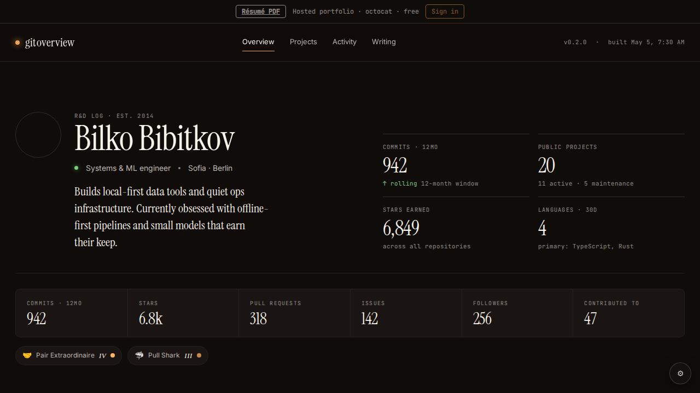

# Validation: hosted-page-polish, empty-activity-notice

Base: ac9a30ff0fb7c68d78d9c85b6753fb43019fc133. Commits: 55b8ad0 (hosted-page-polish), 52f562d (empty-activity-notice).
PRD files found in `prds-archived/` (79, 80). Review done as self-review (correctness, input handling, secrets, duplication).

## hosted-page-polish — VERIFIED
- No `content: 'BB'` in src/styles.css: the `::after` rule became `.hero .portrait .initials` (diff hunk at styles.css:146).
- Hero.tsx: `initialsOf` (first letter of up to 2 words, uppercased, code-point safe) rendered only under `!developer.avatarUrl`; avatar case renders no text.
- App.tsx `OverviewTab`: `showPipeline && tenant === null && <PipelineStrip />` — canonical page keeps behaviour, hosted hides it.
- tests/hosted-chrome.spec.ts case 1: mocks `**/api/git-viewer/u/**`, asserts name heading, no 'offline pipeline', portrait text empty, `::after` content none/normal. Passed.
- Gate (typecheck, test, build:bilko 148.3 KB gz ≤ 200, playwright hosted-chrome + landing): all exit 0 (5 Playwright tests passed).
- Screenshot of mocked `/?u=octocat`: `hosted-octocat.png` (same folder). Shows the hosted banner, the name, an empty round portrait (mock avatar URL is unreachable) with no "BB" overlay, and no "offline pipeline" strip.

## empty-activity-notice — VERIFIED
- `isEmptyActivity` exported at src/data/tenant.ts:82-84 (`totalCommitsYear === 0 && heatmap.every(count <= 0)`; `<= 0` is correct since future days are -1). Unit test in src/data/tenant.test.ts (already in `pnpm test` list); passed.
- App.tsx OverviewTab: notice rendered only when `tenant !== null && isEmptyActivity(data)`, above `<Hero />`, with the PRD text and a "Back to start" link to `window.location.pathname` (root without query). Not shown for owner/canonical (tenant null) or active tenants.
- Playwright: zero-commit case sees "No public commits in the last 12 months for @vitejs."; with-activity case asserts absence. Passed.
- Gate: same command as above, all green.

## Findings
### Critical
- none
### Important
- none
### Minor
- src/App.tsx (empty-notice `
`): no CSS rule exists, so the notice is unstyled plain text (stylesheet was outside the PRD's file list for this PRD).
- Hero.tsx initials: `developer.name` empty yields an empty initials span (harmless).
- Process: this record also adds `hosted-octocat.png` (required screenshot evidence) next to the review file; the PRD's file list names only the .md.
- Dev-lead noted skipping the red-first test run (TDD); no failing-run evidence exists.
- Security self-review: tenant login is rendered via React text nodes (no raw HTML); no secrets, no new fetches; link href is the current pathname only.
