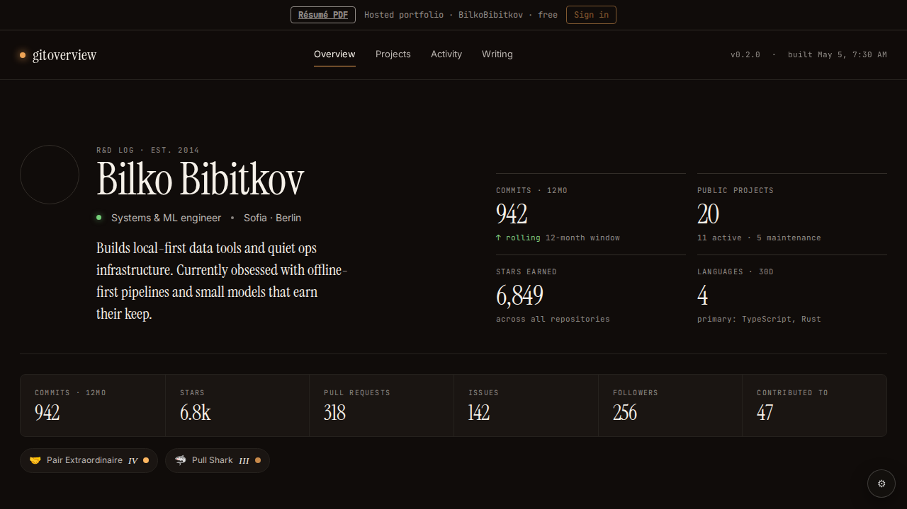

# Validation: persona-alias-loader, persona-owner-login-wiring

Base: 89c286b2 (commits `1b073e2` loader, `cdf70df` wiring). Both PRDs found in `prds-archived/`.

## persona-alias-loader — VERIFIED
- `src/data/persona.ts:3-5` PERSONA_ALIASES holds the BilkoBibitkov/StanislavBG/"Bilko Bibitkov" entry; `:8-12` resolvePersona is case-insensitive on slug or login, else null; `:14-17` maskPersona does JSON stringify, case-sensitive replace of githubLogin, parse.
- `src/data/loader.tsx` Tenant gains `ownerLogin`. A persona fetches `tenantApiUrl(apiLogin)` (apiLogin = persona.githubLogin) and returns `maskPersona(res.data)`. login = slug, ownerLogin = githubLogin. Non-persona: ownerLogin = res.login (equal to login).
- `loader.tsx` calls `history.replaceState` with only `u` set to the slug (other params kept) when login !== slug. Check is before the fetch.
- `landing.ts` exampleLogins = ['BilkoBibitkov','torvalds','gaearon']; `landing.test.ts` updated. `persona.test.ts` covers slug, real login, other login, case, nested masking and untouched lowercase `stanislavbg`; it is in the package.json `test` list.
- Gate `pnpm test && pnpm typecheck && pnpm build:bilko`: all exit 0. The build reports 148.7 KB gz (<= 200).

## persona-owner-login-wiring — VERIFIED
- `HostedActions.tsx`: `githubLinkState(..., tenant.ownerLogin)`, `buildClaimRequest({login: tenant.ownerLogin})` and `<RepoPicker login={h.tenant.ownerLogin}>` use the real login. Auto-claim goes through `claim()`. The ClaimBar label and messages use `tenant.login`.
- With `persona = ownerLogin !== login`, the GitHub-link prompts and the "Choose Continue with GitHub" hint read "the GitHub account that owns this portfolio". RepoPicker was not edited (it already takes `login` as a prop).
- `tests/hosted-chrome.spec.ts:62-97` persona test: the route answers only the stanislavbg path. It checks "Bilko Bibitkov" is visible, the body has no "StanislavBG", the API path was for stanislavbg, and `/?u=StanislavBG` ends on `?u=BilkoBibitkov`.
- Gate: pnpm test, typecheck and build:bilko pass (above). `playwright test tests/hosted-chrome.spec.ts tests/landing.spec.ts` gave 6 passed.
- Screenshot of the mocked `/?u=BilkoBibitkov` page: . The banner reads "Hosted portfolio · BilkoBibitkov · free", the heading is "Bilko Bibitkov", and "StanislavBG" appears nowhere. I captured it by running a temporary copy of the persona spec that added `page.screenshot`; the copy was deleted.

## Findings
- Critical: none. Important: none.
- Minor: `persona.ts:16` masking is case-sensitive by spec. Lowercase forms such as `stanislavbg.github.io` or repo URLs in the data stay unmasked (same as pipeline/sync.ts). The tests assert this, but URLs embedded in the data could still show the real login if rendered.
- Minor: the persona claim-prompt text was not exercised in a browser. The Playwright test covers only masking of the loaded page (the dev report said the same).
- Minor: `/code-review` and `/security-review` were self-reviewed on the diff. There is no path traversal or secret exposure. `u` is set via URLSearchParams and the API login comes from the constant alias table.
